# Laporan UTS Praktik Infrastruktur & Network Attacks

* **Nama:** Muhammad Ikhsan Pradiptianto
* **NIM:** 24552011255
* **Kelas:** TIF-RP-24E-CNS (UTB IF 24)

## Penentuan Studi Kasus

* Penjumlahan Digit NIM: 2 + 4 + 5 + 5 + 2 + 0 + 1 + 1 + 2 + 5 + 5 = 32
* Perhitungan Sisa Bagi: 32 mod 10 = 2
* **Kasus Terpilih:** Kasus 2

---

## Tugas 1 (Pertemuan 1): Docker & Volume Persistensi

### 1. Pembuktian Data Persisten Volume `vol-k2`
Data NIM `24552011255` yang ditulis ke dalam volume `vol-k2` tetap persisten dan dapat dibaca oleh container baru meskipun container pembuat awal (`w-k2`) telah dihapus.

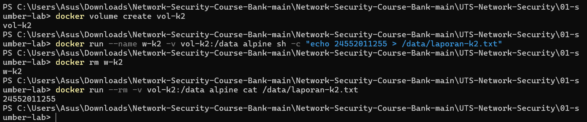

### 2. Pengujian Akses Jaringan Internal Compose B1
Container `attacker` berhasil mengambil halaman utama HTTP dari web server `target` di dalam jaringan internal terisolasi (`internal: true`).

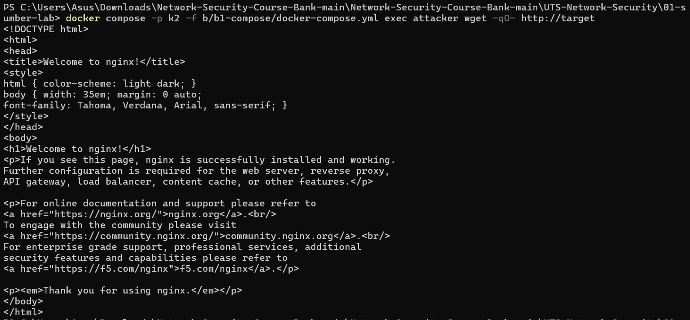

---

## Tugas 2 (Pertemuan 2): Kriptografi AES-256 & Sertifikat Self-Signed

### 1. Enkripsi AES-256-CBC & Integrity Check (SHA-256)
File `laporan-k2.txt` dienkripsi menjadi `laporan-k2.enc` menggunakan algoritma AES-256-CBC dengan kata sandi `kunci-k2-2026`. Integritas data terverifikasi karena nilai hash SHA-256 berkas sebelum enkripsi identik dengan berkas setelah dekripsi (`hasil-k2.txt`).

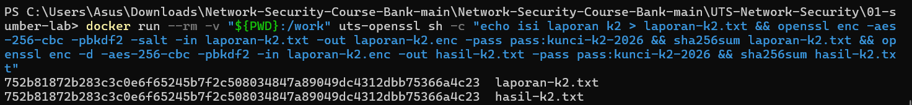

### 2. Penerbitan Sertifikat Self-Signed X.509
Sertifikat SSL/TLS X.509 berdurasi 30 hari berhasil diterbitkan secara lokal untuk Common Name (CN) `k2.uts.local` menggunakan kunci privat RSA 2048-bit (`key-k2.pem`).

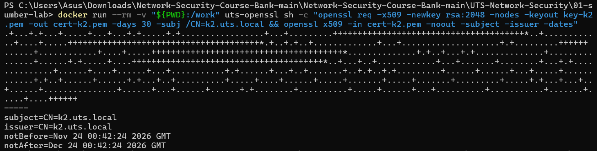

---

## Tugas 3 (Pertemuan 3): ARP Spoofing & Mitigasi Static ARP

### 1. Deteksi Serangan ARP Spoofing
Serangan `arpspoof` dari container `penyerang-k2` berhasil memalsukan alamat MAC gateway (`172.21.0.3`) pada tabel ARP `korban-k2` dari `da:93:1a:bc:8d:fd` menjadi `d2:01:f0:a2:19:6c`.

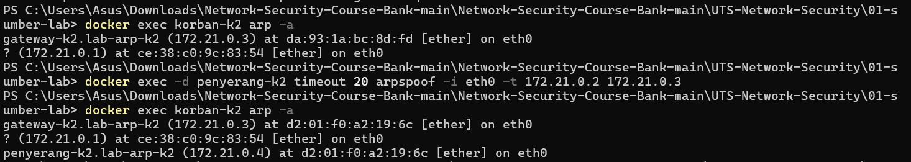

### 2. Penerapan Mitigasi Static ARP
Penguncian entri ARP dilakukan secara statis dengan perintah `arp -s 172.21.0.3 da:93:1a:bc:8d:fd` pada container korban. Alamat MAC gateway terdaftar sebagai entri *PERM* (Permanent) sehingga kebal dari racun ARP (ARP Poisoning).

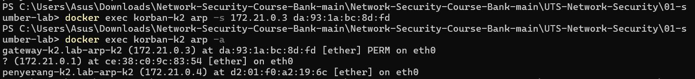

---

## Tugas 4 (Pertemuan 4): Analisis WPA2 4-Way Handshake

### 1. Bukti Eksekusi Aircrack-ng
Pengujian file capture `handshake-k2.cap` dilakukan menggunakan `aircrack-ng` dan pustaka kamus `wordlist-k2.txt`.

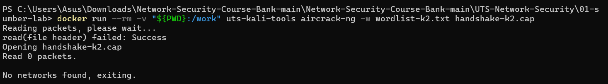

### 2. Penjelasan 4-Way Handshake WPA2
Mekanisme 4-Way Handshake pada protokol WPA2/WPA-Personal bertujuan untuk mengautentikasi klien dan menghasilkan kunci enkripsi sesi (*Pairwise Transient Key / PTK*) tanpa pernah mengirimkan *Passphrase* asli melalui media udara:

1. **Message 1 (AP -> Client):** Access Point (AP) mengirimkan nilai acak *ANonce* ke klien.
2. **Message 2 (Client -> AP):** Klien membuat nilai acak *SNonce*, menghitung PTK (menggunakan PMK dari kata sandi, ANonce, SNonce, dan MAC Address), lalu mengirimkan *SNonce* beserta *Message Integrity Code (MIC)* ke AP.
3. **Message 3 (AP -> Client):** AP memverifikasi MIC, membangkitkan PTK yang sama, lalu mengirimkan *Group Temporal Key (GTK)* dan MIC ke klien.
4. **Message 4 (Client -> AP):** Klien mengonfirmasi penerimaan GTK dan mengirimkan balasan konfirmasi akhir ke AP. Sesi terenkripsi siap digunakan.

---

## Tugas 5 (Pertemuan 5): ICMP dengan Scapy & Analisis Smurf Attack

### 1. Eksekusi Skrip ICMP Scapy
Pengiriman paket ICMP Echo Request ke IP target (`172.21.0.2`) berhasil dieksekusi menggunakan skrip `kirim_icmp.py`. Balasan diterima dengan tipe ICMP Echo Reply (Type 0) dan nilai TTL 64.

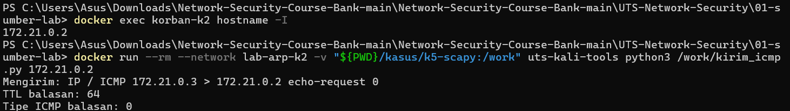

### 2. Penjelasan Smurf Attack
Smurf Attack adalah serangan Denial of Service (DoS) pada Layer 3 yang mengeksploitasi mekanisme ICMP Broadcast:

1. Penyerang memalsukan (*IP Spoofing*) alamat IP sumber paket ICMP Echo Request menjadi alamat IP milik korban.
2. Penyerang mengarahkan paket permintaan ICMP tersebut ke alamat *IP Broadcast* suatu subnet.
3. Seluruh host aktif di dalam subnet merespons dengan mengirimkan paket ICMP Echo Reply secara bersamaan ke IP korban.
4. Lonjakan lalu lintas (*flooding*) tersebut menguras bandwidth dan melumpuhkan kapasitas pemrosesan jaringan korban.

---

## Tugas 6 (Pertemuan 6): DoS SYN Flood & Mitigasi TCP SYN Cookies

### 1. Bukti Monitoring Serangan SYN Flood
Serangan *SYN Flood* dieksekusi menggunakan `hping3` dengan flag `-S --flood` menuju port 80 target (`172.21.0.2`). Monitoring tabel socket menggunakan `netstat` memperlihatkan penumpukan antrean koneksi `SYN_RECV` akibat paket SYN yang tidak menyelesaikan proses 3-Way Handshake.

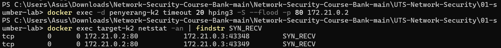

### 2. Penerapan Mitigasi TCP SYN Cookies
Verifikasi status `net.ipv4.tcp_syncookies` pada kernel target menunjukkan nilai `1` (aktif). Fitur ini mencegah kehabisan memori *SYN backlog queue* dengan mengodekan parameter koneksi ke dalam urutan nomor *Initial Sequence Number (ISN)* tanpa mengalokasikan memori sebelum koneksi TCP terbentuk sepenuhnya.

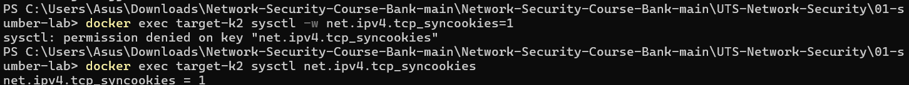

---

## Tugas 7 (Pertemuan 7): DNS Security, Exfiltration & Cache Poisoning

### 1. Pengujian Resolusi DNS Domain `k2.exfil.lab`
Pengujian resolusi nama domain dilakukan dari container `klien-k2` menggunakan perintah `dig` menuju DNS Server `dns-k2` (`172.21.0.2`). Respons diterima pada `ANSWER SECTION` dengan status `NOERROR`.

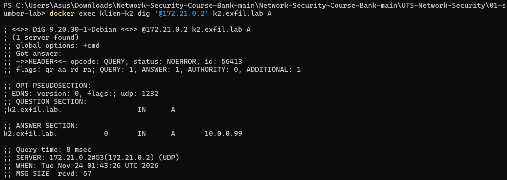

### 2. Penjelasan Singkat Risiko DNS Exfiltration & Cache Poisoning
1. **DNS Exfiltration:** Teknik pencurian data rahasia dengan menyisipkan fragmen data terenkripsi ke dalam query/subdomain DNS (contoh: `data-rahasia.k2.exfil.lab`). Karena lalu lintas DNS port 53 UDP jarang diblokir oleh firewall, penyerang dapat meloloskan data keluar jaringan secara diam-diam.
2. **DNS Cache Poisoning:** Serangan dengan menyuntikkan catatan IP palsu ke dalam pemcache DNS server resolver. Dampaknya, ketika pengguna meminta domain sah (seperti `k2.exfil.lab`), resolver mereturn IP milik penyerang sehingga korban diarahkan ke situs *phishing* atau *malicious server*.
